# Bars4J - A simple, fast and effective way to include barcodes in java applications.
This project aims to create a java library (framework) for barcode creation. It is a revival of an old project I had at SourceForge, called JBarcode and now it has been renamed to Bars4J. The main features are support for a wide variety of standards, simplicity of including barcodes in Java applications and high performance with low memory consumption.

Barcodes Supported: EAN13, EAN8, UPCA, UPCE, Codabar, Code 11, Code 128, Code 39, Code 39 Extended, Code 93, Code 93 Extended, Standard 2of5, Interleaved 2of5, IATA 2of5, Datalogic 2of5, Matrix 2of5, MSI Plessey, PostNet, QRCode (2D) and Data Matrix (2D).

## Simple and fast

To use the library just import the jar and follow the examples below:

Image Format:
```
...
//Creates a EAN13 barcode
Barcode b4j = BarcodeFactory.getInstance().createEAN13();
String code = "079357367940";
//Export as IMG
BufferedImage img = b4j.createBarcode(code);
...
```

SVG Format:
```
...
//Creates a Code128 barcode
Barcode b4j = BarcodeFactory.getInstance().createCode128();
String code = "Bars4J Code 128";
//Export as SVG
StringBuffer svg = b4j.createBarcodeSVG(code);
...
```

## QRCode (2D)

QRCode is generated through the unified format registry, which returns a matrix symbol. It supports
versions 1-40, error correction levels L/M/Q/H and the numeric, alphanumeric, byte and Kanji modes.
The implementation is self-contained: there is no runtime dependency on any external QR library
(ZXing is only used in the tests for cross-validation).

```
...
//Creates a QRCode barcode
BarcodeGenerator generator = BarcodeGenerator.of("QRCODE");

//Export as IMG
BufferedImage img = generator.toImage("Bars4J");

//Export as SVG
String svg = generator.toSvg("Bars4J");
...
```

## Data Matrix (2D)

Data Matrix (ECC200) is also available through the unified registry. It supports the standard square
and rectangular symbols with full Reed-Solomon error correction and interleaving, using ASCII
encodation (ISO-8859-1 input). Like the QRCode implementation it has no runtime dependency.

```
...
//Creates a Data Matrix barcode
BarcodeGenerator generator = BarcodeGenerator.of("DATAMATRIX");

//Export as IMG
BufferedImage img = generator.toImage("Bars4J");

//Export as SVG
String svg = generator.toSvg("Bars4J");
...
```

The same `BarcodeGenerator.of("<format id>")` entry point works for every registered format,
e.g. `BarcodeGenerator.of("EAN13").toSvg("789100031550")`. The list of ids is available from
`BarcodeRegistry.getInstance().ids()`.

## Building and running the demos

Build and run the tests:

```
mvn test
```

Run the demos (output is written to `./images`). `mvn exec:java` runs `QRCodeDemo` by default;
pass `-Dexec.mainClass=...` to run another one:

```
mvn exec:java                                                # QRCodeDemo
mvn exec:java -Dexec.mainClass=org.bars4j.demo.SimpleDemo     # all 1D formats + QRCode
mvn exec:java -Dexec.mainClass=org.bars4j.demo.SwingDemo      # Swing UI
```

Alternatively, run a demo class directly from `target/classes`:

```
mvn compile
java -cp target/classes org.bars4j.demo.QRCodeDemo
```

> Note: `java -jar target/bars4j-*.jar` does not work because this is a library jar (it has no
> `Main-Class`). Use one of the commands above.

### Desktop demo (Swing)

`SwingDemo` is an interactive desktop application:

```
mvn exec:java -Dexec.mainClass=org.bars4j.demo.SwingDemo
```

* pick any registered format (1D or 2D) from the format list;
* edit the content and the format-specific options — the preview updates in real time;
* **linear** options: x-dimension, bar height, wide ratio, human-readable text, check digit;
* **matrix** options: module size, foreground and background colours;
* zoom the preview with the mouse wheel (double-click resets the zoom);
* **Print…** sends the barcode to a printer (scaled to fit and centred on the page);
* **Export PNG…** / **Export SVG…** save the current result.

## SVG Barcode Samples

### EAN / UPC

| EAN13 | EAN8 | UPCA | UPCE |
|----------|:-------------:|:------:|------|
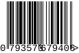 | 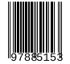 | 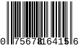 | 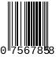 |

### Codes
| Code 39 | Code 39 Extended |
|----------|-------------|
| 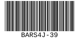 | 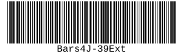 |

| Code 93 | Code 93 Extended |
|----------|-------------|
| 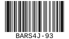 | 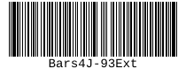 |

| Codabar | Code 11 | 
|----------|-------------|
| 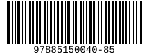 | 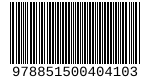 |

| Code 128 | MSI Plessey | 
|----------|-------------|
| 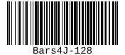 | 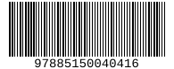 |

### ITF

| Standard 2of5 | Interleaved 2of5 |
|----------|-------------|
| 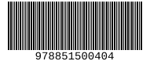 | 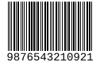 | 

| IATA 2of5 | Matrix 2of5 | Datalogic 2of5 |
|----------|-------------|----------|
| 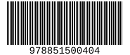 |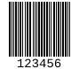 |  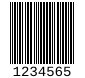 |

### PostNet


### QRCode (2D)
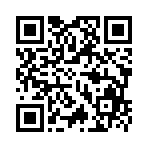

### Data Matrix (2D)
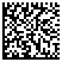
