# Bars4J - A simple, fast and effective way to include barcodes in java applications.
This project aims to create a java library (framework) for barcode creation. It is a revival of an old project I had at SourceForge, called JBarcode and now it has been renamed to Bars4J. The main features are support for a wide variety of standards, simplicity of including barcodes in Java applications and high performance with low memory consumption.

Barcodes Supported: EAN13, EAN8, UPCA, UPCE, Codabar, Code 11, Code 128, Code 39, Code 39 Extended, Code 93, Code 93 Extended, Standard 2of5, Interleaved 2of5, ITF-14, IATA 2of5, Datalogic 2of5, Matrix 2of5, MSI Plessey, PostNet, QRCode (2D), Data Matrix (2D), PDF417 (2D) and Aztec (2D).

## Quick Start

Bars4J is available for **Java** (this repository) and for **Node.js / TypeScript**
([`@bars4j/core`](https://www.npmjs.com/package/@bars4j/core) on npm). Both expose the same unified
entry point — `BarcodeGenerator.of("<format id>")` — and render to SVG or to a raster image.

### Java

Requires **JDK 17+**.

Download the jar from the [releases page](https://github.com/ronison/bars4j/releases)
(`bars4j-<version>.jar`, plus the `-sources` jar) and add it to your classpath, or build it from
source:

```
git clone https://github.com/ronison/bars4j.git
cd bars4j
mvn package      # produces target/bars4j-<version>.jar and target/bars4j-<version>-sources.jar
```

It is also published to GitHub Packages (`maven.pkg.github.com/ronison/bars4j`):

```xml
<dependency>
  <groupId>org.bars4j</groupId>
  <artifactId>bars4j</artifactId>
  <version>0.7.2</version>
</dependency>
```

```java
import java.awt.image.BufferedImage;
import org.bars4j.api.BarcodeGenerator;

BarcodeGenerator generator = BarcodeGenerator.of("EAN13");
String svg = generator.toSvg("789100031550");           // SVG markup
BufferedImage image = generator.toImage("789100031550"); // AWT image
```

### Node.js / TypeScript

Requires **Node.js 22.18+** — it runs the TypeScript sources directly, with no build step.

```sh
npm install @bars4j/core
```

Human-readable labels on raster images use an optional font backend:

```sh
npm install @napi-rs/canvas
```

```ts
import { BarcodeGenerator, encodePng } from "@bars4j/core";

const svg = BarcodeGenerator.of("EAN13").toSvg("789100031550");
const image = BarcodeGenerator.of("EAN13").toImage("789100031550"); // ARGB image buffer
const png = encodePng(image);                                       // Uint8Array (no native dependency)
```

See [`node/README.md`](node/README.md) for the full format list, the `bars4j` CLI and the demos.

## Simple and fast

To use the library just import the jar and follow the examples below:

Image Format:
```
...
//Creates a EAN13 barcode
BarcodeGenerator generator = BarcodeGenerator.of("EAN13");

//Export as IMG
BufferedImage img = generator.toImage("079357367940");
...
```

SVG Format:
```
...
//Creates a Code128 barcode
BarcodeGenerator generator = BarcodeGenerator.of("CODE128");

//Export as SVG
String svg = generator.toSvg("Bars4J Code 128");
...
```

## QRCode (2D)

QRCode is generated through the unified format registry, which returns a matrix symbol. It supports
versions 1-40, error correction levels L/M/Q/H and the numeric, alphanumeric, byte and Kanji modes.
The implementation is self-contained: there is no runtime dependency on any external QR library
(ZXing is only used in the tests for cross-validation).

```
...
//Creates a QRCode barcode
BarcodeGenerator generator = BarcodeGenerator.of("QRCODE");

//Export as IMG
BufferedImage img = generator.toImage("Bars4J");

//Export as SVG
String svg = generator.toSvg("Bars4J");
...
```

## Data Matrix (2D)

Data Matrix (ECC200) is also available through the unified registry. It supports the standard square
and rectangular symbols with full Reed-Solomon error correction and interleaving, using ASCII
encodation (ISO-8859-1 input). Like the QRCode implementation it has no runtime dependency.

```
...
//Creates a Data Matrix barcode
BarcodeGenerator generator = BarcodeGenerator.of("DATAMATRIX");

//Export as IMG
BufferedImage img = generator.toImage("Bars4J");

//Export as SVG
String svg = generator.toSvg("Bars4J");
...
```

## PDF417 (2D)

PDF417 (ISO/IEC 15438) is available through the unified registry. It supports the text, byte and
numeric compaction modes (with automatic selection), error-correction levels 0-8 and the full
range of symbol sizes. Like the other 2D formats it has no runtime dependency.

```
...
//Creates a PDF417 barcode
BarcodeGenerator generator = BarcodeGenerator.of("PDF417");

//Export as IMG
BufferedImage img = generator.toImage("Bars4J");

//Export as SVG
String svg = generator.toSvg("Bars4J");
...
```

## Aztec (2D)

Aztec (ISO/IEC 24778) is available through the unified registry. It supports compact and full
symbols, all five modes of the high-level encoder, automatic error-correction selection and
automatic layer detection. It also has no runtime dependency.

```
...
//Creates an Aztec barcode
BarcodeGenerator generator = BarcodeGenerator.of("AZTEC");

//Export as IMG
BufferedImage img = generator.toImage("Bars4J");

//Export as SVG
String svg = generator.toSvg("Bars4J");
...
```

The same `BarcodeGenerator.of("<format id>")` entry point works for every registered format,
e.g. `BarcodeGenerator.of("EAN13").toSvg("789100031550")`. The list of ids is available from
`BarcodeRegistry.getInstance().ids()`.

## ITF-14 (GS1 GTIN-14)

ITF-14 encodes the 14-digit GS1 Identification Key (13 data digits followed by the GS1 mod-10 check
digit) with the Interleaved 2 of 5 symbology, framed by the mandatory GS1 bearer bars (a horizontal
bar above and below the symbol spanning the whole symbol, including the quiet zones). The
human-readable label uses the ITF-14 HRI mask `0 00 00000 00000 0` (e.g. `1 54 00141 28876 3`).

```
...
//Creates an ITF-14 barcode
BarcodeGenerator generator = BarcodeGenerator.of("ITF14");

//Export as IMG (13 data digits: the check digit is computed and appended)
BufferedImage img = generator.toImage("1540014128876");

//Export as SVG (complete 14-digit code: the check digit is validated)
String svg = generator.toSvg("15400141288763");
...
```

The input may be either the 13 data digits or the complete 14-digit code; a wrong check digit or an
invalid length is rejected with an `InvalidSymbolException`.

### Check digits

For the formats with an external check digit (EAN-13, EAN-8, UPC-A, UPC-E and ITF-14) the input may
be given either as the payload alone or as the complete code including its check digit:

* **payload only** — the check digit is computed and appended before encoding
  (`EAN13`: 12 digits, `EAN8`: 7, `UPCA`: 11, `UPCE`: 7, `ITF14`: 13);
* **complete code** — the supplied check digit is validated and kept verbatim
  (13, 8, 12, 8 and 14 digits respectively); a wrong check digit is rejected with an
  `InvalidSymbolException`.

The `BarcodeGenerator` facade accepts both forms. The raw encoders (`Ean13Encoder`, `Ean8Encoder`,
`UpcaEncoder`, `UpceEncoder`, `Itf14Encoder`) accept the complete code and validate it; `EAN13` (12),
`UPCA` (11) and `ITF14` (13) also accept the payload alone, while `EAN8`/`UPCE` raw encoders expect
the complete 8-digit code (the facade is what appends their check digit). Each exposes
`completeLength()` for the full length.

> Note: the shared 2-of-5 check digit is computed with the GS1 weights anchored to the right of the
> payload. This matches the previous behaviour for even-length payloads and fixes the odd-length
> case (e.g. the 13 data digits of an ITF-14/GTIN-14).

## Building and running the demos

Build and run the tests:

```
mvn test
```

Run the full verification, including the automated performance gate:

```
mvn verify
```

`mvn verify` also runs `PerformanceIT`, which measures image throughput and tail latency
(p50/p99) for every registered format and fails the build if any format falls below a conservative
budget. The measured numbers are printed to the build log. The gate is intentionally generous so it
catches large regressions (e.g. losing the bulk-raster path in `MatrixRenderer`) without being flaky
on slower CI machines; see `src/test/java/org/bars4j/PerformanceIT.java` to tune the thresholds.

Run the demos (output is written to `./images`). `mvn exec:java` runs `QRCodeDemo` by default;
pass `-Dexec.mainClass=...` to run another one:

```
mvn exec:java                                                # QRCodeDemo
mvn exec:java -Dexec.mainClass=org.bars4j.demo.SimpleDemo     # all 1D formats + QRCode
mvn exec:java -Dexec.mainClass=org.bars4j.demo.SwingDemo      # Swing UI
```

Alternatively, run a demo class directly from `target/classes`:

```
mvn compile
java -cp target/classes org.bars4j.demo.QRCodeDemo
```

> Note: `java -jar target/bars4j-*.jar` does not work because this is a library jar (it has no
> `Main-Class`). Use one of the commands above.

### Desktop demo (Swing)

`SwingDemo` is an interactive desktop application:

```
mvn exec:java -Dexec.mainClass=org.bars4j.demo.SwingDemo
```

* pick any registered format (1D or 2D) from the format list;
* edit the content and the format-specific options — the preview updates in real time;
* **linear** options: x-dimension, bar height, wide ratio, human-readable text, check digit;
* **matrix** options: module size, foreground and background colours;
* zoom the preview with the mouse wheel (double-click resets the zoom);
* **Print…** sends the barcode to a printer (scaled to fit and centred on the page);
* **Export PNG…** / **Export SVG…** save the current result.

## SVG Barcode Samples

### EAN / UPC

| EAN13 | EAN8 | UPCA | UPCE |
|----------|:-------------:|:------:|------|
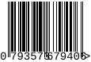 | 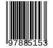 | 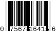 | 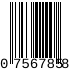 |

### Codes
| Code 39 | Code 39 Extended |
|----------|-------------|
| 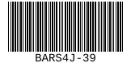 | 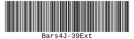 |

| Code 93 | Code 93 Extended |
|----------|-------------|
| 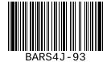 | 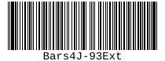 |

| Codabar | Code 11 | 
|----------|-------------|
| 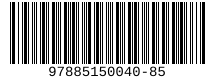 | 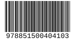 |

| Code 128 | MSI Plessey | 
|----------|-------------|
| 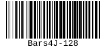 | 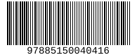 |

### ITF

| Standard 2of5 | Interleaved 2of5 | ITF-14 |
|----------|-------------|-------------|
| 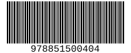 | 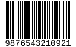 | 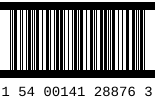 | 

| IATA 2of5 | Matrix 2of5 | Datalogic 2of5 |
|----------|-------------|----------|
| 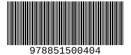 |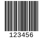 |  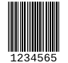 |

### PostNet
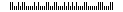

### QRCode (2D)
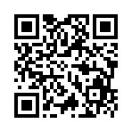

### Data Matrix (2D)
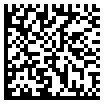

### PDF417 (2D)


### Aztec (2D)
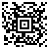
